[](https://github.com/abjanssen/Readzor/releases)
[](https://www.gnu.org/licenses/gpl-3.0)
[](https://www.python.org/)
[](https://doi.org/10.5281/zenodo.22336649)
[](https://pypi.org/project/Readzor/)
[](https://anaconda.org/channels/bioconda/packages/readzor/overview)
[](https://github.com/abjanssen/Readzor/pkgs/container/readzor)

# Welcome to Readzor 

**Readzor** is a fast, modular, fully-featured FASTQ quality trimming and filtering pipeline. \
All processing modules are off by default, giving you full control over your workflow.

## Feature overview
**Modular trimming approach**:
By design, each filter will independently assess each raw read. Outcomes are merged, and the most stringent trimming result per end is applied.\
For example, if the quality trimmer determines 5 bases should be removed from the 3' end, but the adapter trimmer identifies 12 bases to remove from that same end, Readzor will merge these outcomes and trim the most restrictive amount (12 bases) to ensure high-quality output.
*   Quality-dependent end trimming.
*   Sliding window quality trimming.
*   Homopolymer trimming, from both read ends.
*   Adapter trimming with built-in Illumina adapter groups (TruSeq, TruSeq small RNA, Illumina miRNA, Nextera, AmpliSeq, TruSeq DNA methylation, TruSeq Ribo-Profile, and Illumina RNA), with optional mismatches and detection of partial adapters at the 3' end.
*   Overlap-based adapter trimming for paired and interleaved reads, independent of the adapter sequence.
*   N-base trimming from both read ends, and overall N-base filtering.
*   K-mer based low complexity filtering.
*   Set-length read end trimming.
*   Average input and output quality thresholds.
*   Input and output length thresholds (absolute, or as a percentage of the input read length).
    
**Auto-detection**:
Using auto-detection methods, Readzor provides an easy-to-use platform for novice users, enabling high quality read trimming with minimal inputs.
*   File Pairing: paired vs. unpaired vs. interleaved FASTQ files detection using internal header information, independent of file names.
*   Read Numbering: read numbers detection when needed, directly from headers.
*   Compression: Gzip compression detection via magic bytes, regardless of the file extension.
*   Phred Offsets: per-file Phred quality offsets detection (i.e., Phred33 vs. Phred64) based on quality string symbols.

**Extra features**:
Equipped with a number of other features, like built-in validation and seamless HPC cluster detection methods, Readzor delivers a robust execution environment, ensuring reproducible outputs at any scale.
*   Fully automatic mode: invoking Readzor in fully automatic mode (optional file specification possible), will use predetermined settings to optimize read processing. For more info, invoke Readzor with flags --full-auto and --help.
*   MGI/BGI header conversion: Built-in module to convert MGI/BGI fastq headers into standard Illumina format for downstream compatibility (e.g., with SAMtools).
*   Safe and traceable outputs: Automatically generates isolated, timestamped output directories to prevent accidental file overwrites. Each run includes a log file recording the exact command and all parameters used, and a summary file with the kept and rejected read counts per input, for full reproducibility.
*   HPC integration: Automatically reads HPC cluster environment variables to seamlessly scale threads and optimize performance on HPC clusters.
*   Live progress monitoring: Features a dynamic progress tracker to accurately provide real-time feedback on processing speed, completion, and estimated time remaining.
*   Real-time record validation: Readzor detects malformed or corrupted FASTQ records on the fly, ensuring high-quality output.
*   Gzip compression: Compress your output files and control the compression depth to optimize storage size.
*   Test run: Perform a short test run according to specified settings, printing verbose output to screen, to catch config errors before committing to a full run. No output files are kept.
*   Piping: Read FASTQ data from stdin and stream the filtered reads to stdout, to use Readzor inside a pipeline.
*   Rejected reads: Optionally write all rejected reads to separate files for inspection.

## Input data requirements
*  Readzor can handle a mix of gzipped or normal text files as input simultaneously, different file types will be handled dynamically.
*  For auto-detection of FASTQ files in the current working directory (--full-auto without input files), the file names should end in .fastq or .fq, optionally followed by .gz or .gzip.
*  Additional adapter sequences should be specified as a fasta file.

## Installation and testing
Installation of Readzor is made easy through pip and conda, but you can also clone this repository:

### Bioconda
```bash
conda search readzor
conda install readzor
readzor --version
```

### Docker
```bash
docker pull ghcr.io/abjanssen/readzor:latest
docker run --rm ghcr.io/abjanssen/readzor:latest --version
```

### Github 
```bash
git clone https://github.com/abjanssen/Readzor.git
pip install numpy==2.5.2
pip install isal==1.8.0
cd Readzor/src/readzor
chmod u+x readzor.py
python readzor.py --version
```

### Pip
```python
pip install readzor
import readzor
print(readzor.VERSION)
```

## Using Readzor 

### Beginner
```
# Use predetermined settings, and let Readzor detect the files (and their pairing) in your current working directory:
% readzor -GO
```

### Beginner+
```
# Use predetermined settings, but specify your files

# Rely on Readzor's paired-file detection:
% readzor -GO --input-files /path/to/input/files

# Specify paired files:
% readzor -GO --input-paired /path/to/paired/files

# Specify unpaired files:
% readzor -GO --input-unpaired /path/to/unpaired/files

# Specify a combination: 
% readzor -GO --input-unpaired /path/to/unpaired/files --input-paired /path/to/paired/files
```

### Novice
```
# Adapt the workflow according to your needs by specifying specific trimming modules

# Turn on quality-dependent end trimming, use its default settings:
% readzor --input-files /path/to/input/files --endqual-filter-flag

# Turn on adapter trimming, use its default settings:
% readzor --input-files /path/to/input/files --adapter-filter-flag

# Turn on multiple trimming modules:
% readzor --input-files /path/to/input/files --adapter-filter-flag --endqual-filter-flag
```

### Advanced
```
# Detail the module settings according to your needs by specifying trimming parameters

# Turn on quality-dependent end trimming, use custom settings:
% readzor --input-files /path/to/input/files --endqual-filter-flag --endqual-min-start 25 --endqual-min-end 25

# Turn on adapter trimming, add custom sequences:
% readzor --input-files /path/to/input/files --adapter-filter-flag --adapter-fasta-add /path/to/fasta/file

# Turn on adapter trimming with a specific built-in adapter group, allowing one mismatch:
% readzor --input-files /path/to/input/files --adapter-filter-flag --adapter-group Nextera --adapter-mismatch 1

# Read from stdin and stream the filtered reads to stdout:
% cat reads.fastq | readzor --endqual-filter-flag --stdout > filtered.fastq
```

## Command line options 
All modules are off by default. To use a module, specify a module flag. Further specification of module settings is possible using the appropiate options.

### General settings
General options for help, version information, automatic mode, and console output.\
`--help, -h` [FLAG]: Show this help message and exit. Combine with --full-auto/-GO for more information on fully automatic mode.\
`--version, -v` [FLAG]: Show Readzor version and exit.\
`--list-adapters` [FLAG]: Show all built-in adapter sequences and exit.\
`--full-auto, -GO` [FLAG]: Run Readzor in fully automatic mode. Combine with --help/-h for more information on fully automatic mode.\
`--progress` [FLAG]: Show a live progress bar and estimated time remaining during processing, based on estimated read counts. Default: off.\
`--verbose` [FLAG]: Write verbose output to terminal, in addition to the log file. Default: off.
    
### Input options
Specify input FASTQ files using any combination of --input-files, --input-paired, --input-unpaired, and --input-interleaved. Lists with any combination of regular (fastq/fq) and gzipped (fastq.gz/fq.gz) files accepted. If no input flags are provided, data will be read directly from standard input (stdin). With --full-auto and no input flags, FASTQ files in the current working directory are used instead.\
`--input-files, -i`: FASTQ files of unspecified pairing. Paired, interleaved, and unpaired files will be auto-detected.\
`--input-interleaved, -ii`: Interleaved FASTQ files. Note: these files will be split in forward and reverse reads.\
`--input-paired, -ip`: Paired-end FASTQ files, given as one or more R1/R2 pairs, e.g. --input-paired sample1_R1 sample1_R2 sample2_R1 sample2_R2.\
`--input-unpaired, -iu`: Unpaired FASTQ files.

### Output options
Filtered sequences can be either written to file, or output to stdout. Setting --stdout overrides other settings.\
`--gzip` [FLAG]: Compress filtered FASTQ files in gzip format using isal. Default: off.\
`--gzip-level`: Set gzip compression level. Higher compression decreases processing speed. Possible values: 0-3. Default: 1.\
`--interleaved-out` [FLAG]: Interleave surviving read pairs of paired and interleaved input files into one output file. Single surviving reads are still written to separate files. Default: off.\
`--output, -o`: Path to directory in which the timestamped results folder will be created. Default: current working directory.\
`--stdout` [FLAG]: Stream resulting FASTQ reads to stdout. Forces --interleaved-out and --discard-singles for paired and interleaved files. Overrides --verbose, --progress, and --write-rejected to off. Overridden to 'off' by --gzip. Note: all files will be streamed one after another, without any separators. Default: off.\
`--write-rejected` [FLAG]: Write rejected reads to file. Either one (for unpaired and when --interleaved-out is set), or two (for forward and reverse reads) are produced. Overridden to 'off' when --stdout is set. Default: off.\
`--discard-singles` [FLAG]: Discard single leftover reads. For paired and interleaved reads, single surviving reads will be discarded instead of written to a separate file. No effect on unpaired read filtering. Default: off.
             
### General quality filters
Filters raw input, or trimmed output sequences for overall parameters. When a read does not pass these filters, it is discarded entirely.\
`--min-average-qual-pre`: Minimum average quality of input read. Possible values: 0-127. Default: 0.\
`--min-average-qual-post`: Minimum average quality of output read. Possible values: 0-127. Default: 0.\
`--min-length-input`: Minimum length for input read. Default: off.\
`--max-length-input`: Maximum length for input read. Default: off.\
`--min-length-output`: Minimum length of output read in absolute number of nucleotides. Overrides --min-length-output-perc when both set. Default: off.\
`--min-length-output-perc`: Minimum length of output read as percentage of input read. Overridden by --min-length-output when both set. Default: off.\
`--max-length-output`: Maximum length of output read in absolute number of nucleotides. Overrides --max-length-output-perc when both set. Default: off.\
`--max-length-output-perc`: Maximum length of output read as percentage of input read. Overridden by --max-length-output when both set. Default: off.\
`--n-filter` [FLAG]: Reject reads containing `N` bases anywhere in read. Turns off N nucleotide end trimming. Default: off.

### Set-Length end trimming
Trim a set number of bases of the ends of each rea g`d, independent of sequence or quality.\
`--cut-flag, -cf` [FLAG]: Turn on the set-length end trimming module. Default: off.\
`--cut-start, -cs`: Number of bases to trim from the start of the read. Default: 0.\
`--cut-end, -ce`: Number of bases to trim from the end of the read. Default: 0.\
`--cut-both, -cb`: Number of bases to trim from both ends of the read. Overwritten by --cut-start and --cut-end. Default: 0.

### Quality-dependent end trimming
Trim the ends of each read for quality, up to the first position that fulfills quality requirements.\
`--endqual-filter-flag, -ef` [FLAG]: Turn on quality-dependent end trimming. Default: off.\
`--endqual-min-start, -ems`: Specific phred score threshold for the start of the read. Default: 20.\
`--endqual-min-end, -eme`: Specific phred score threshold for the end of the read. Default: 20.\
`--endqual-min-both, -emb`: Phred score threshold for the quality trimming of read ends. Overwritten by --endqual-min-start and --endqual-min-end. Default: 20

### Sliding window quality trimming
Trim the reads for quality based on a sliding window of size X, moved with stepsize Y. In case of mid-read quality dropoff, the longest portion survives. In case of a tie, the portion with the highest average quality survives.\
`--slider-filter-flag, -sf` [FLAG]: Turn on sliding window quality trimming module. Default: off.\
`--slider-window, -sw`: Window size over which average quality is calculated. Default: 5.\
`--slider-quality, -sq`: Minimum average quality in sliding window. Default: 20.\
`--slider-step, -ss`: Sliding window step size. Default: 1.

### Homopolymer nucleotide trimming
Illumina NovaSeq, NextSeq, and MiniSeq use a two-color chemistry, in which guanine bases are unlabeled. In event of short fragments, this can result in homopolymer G calls at the end of reads. This filter allows for G, and/or other bases, to be cut.\
`--poly-filter-flag, -pf` [FLAG]: Turn on homopolymer read-end trimming module. Default: off.\
`--poly-bases-start, -pbs`: Base(s) to check for a homopolymer run at start of read. Comma-separated bases are checked independently. Default: none.\
`--poly-bases-end, -pbe`: Base(s) to check for a homopolymer run at end of read. Comma-separated bases are checked independently. Default: "G".\
`--poly-bases-both, -pbb`: Base(s) to check for a homopolymer run at both read ends. Comma-separated bases are checked independently. Overwritten by --poly-bases-start and --poly-bases-end. Default: none.\
`--poly-length-start, -pls`: Minimum length of homopolymer run at start of read required to trigger trimming. Default: off. A value of 0 disables trimming at the start.\
`--poly-length-end, -ple`: Minimum length of homopolymer run at end of read required to trigger trimming. Default: 10. A value of 0 disables trimming at the end.\
`--poly-length-both, -plb`: Minimum length of homopolymer run at start and end of read required to trigger trimming. Used for an end whose own length is not given. Default: off.

### Adapter trimming
Trim reads for adapter sequences. Each read is cut at the earliest adapter occurrence; adapters running off the 3' end are detected down to --adapter-seed bases. For paired reads, only the adapter belonging to each mate (Read 1 or Read 2) of a built-in group is searched for. Use --list-adapters to show all built-in sequences. Adapter trimming is performed independent of quality. Can be combined with overlap trimming (--overlap-filter-flag).\
`--adapter-filter-flag, -af` [FLAG]: Turn on adapter trimming module. Default: off.\
`--adapter-group, -ag`: Specify the group(s) of adapters to be used. Ignored if --adapter-fasta-excl is set. Choices: all, TruSeq, TruSeq_small_RNA, Illumina_miRNA, Nextera, AmpliSeq, TruSeq_DNA_methylation, TruSeq_Ribo_profile, Illumina_RNA. Default: TruSeq.\
`--adapter-seed, -as`: Minimal 5'-end match length. Shorter seeds can result in more partial hits found at end of reads. Default: 6.\
`--adapter-mismatch, -am`: Number of mismatches allowed in adapter finding (substitutions only). For partial adapters at the 3' end, the allowed number is scaled down to the matched length. Default: 0.\
`--adapter-fasta-add, -ad`: Fasta file with adapter sequences to trim for, in addition to defined sequences from --adapter-group.\
`--adapter-fasta-excl, -ax`: Fasta file with adapter sequences to trim for, excluding predefined and additional sequences specified.

### Overlap trimming
Perform overlap analysis to trim adapter sequences. Works independently of adapter sequence. Only available for paired and interleaved reads. Can be combined with --adapter-filter-flag.\
`--overlap-filter-flag, -of` [FLAG]: Turn on overlap trimming module. Default: off.\
`--overlap-mismatches, -om`: Maximum mismatches allowed in the overlapping region. Default: 5.\
`--overlap-min-length, -ol`: Minimum overlap length between the paired reads. Default: 30.\
`--overlap-portion-mismatch, -op`: Maximum percentage of mismatched bases allowed in the overlapping region. Default: 10.
    
### Low complexity filtering
Detect complexity of reads using k-mer-based nucleotide frequencies. Low complexity reads are discarded entirely.\
`--kmer-filter-flag, -kf` [FLAG]: Turn on the k-mer-based complexity filtering module. Default: off.\
`--kmer-size, -ks`: K-mer length for k-mer-based complexity filtering. Comma-separated values are checked independently. Maximum value: 21. Default: 4.\
`--kmer-cutoff, -kc`: Minimum percentage of unique k-mers (relative to the maximum possible for the read) required to pass the complexity filter. Higher values are stricter. Default: 50.

### MGI header conversion
Convert read header from MGI (BGI) format to Illumina format. Original header will be discarded.\
`--mgi-convert-flag, -mf` [FLAG]: Turn on the MGI-to-Illumina header conversion module. Default: off.\
`--mgi-bc5, -m5`: Input an i5 barcode for Illumina header conversion. Default: 'PLACEHOLDERi5'.\
`--mgi-bc7, -m7`: Input an i7 barcode for Illumina header conversion. Default: 'PLACEHOLDERi7'.\
`--mgi-instrument, -mi`: Instrument name for Illumina header conversion. Default: 'PLACEHOLDERinstrument'.\
`--mgi-run, -mr`: Run ID for Illumina header conversion. Default: 'PLACEHOLDERrun'.

### Advanced options
Further options that can be specified to alter the behavior of Readzor.\
`--threads, -t`: Number of threads to use. Default: platform-dependent through auto-detection (assigned CPUs on HPC cluster systems, all-1 otherwise. Fallback: 1).\
`--reads-for-phred-offset`: Number of reads to sample per file for detection of Phred quality encoding offset. Default: 500.\
`--chunk-size`: Number of reads per chunk sent to each worker. Changing can alter processing speed. Default: 1500.\
`--phred-offset`: Define phred offset for all FASTQ files. When set, per-file auto-detection will not be performed. Possible values: 33, 64. Default: off (auto-detection per file).\
`--testrun`: Perform a limited test run according to specified settings: only the first chunks of each input are processed (one per thread), and all output, including the log and summary files, is deleted afterwards. Also sets --verbose. Default: off.\
`--ordered-output`: Force writing output reads in the same order as the input reads, with the exception of filtered reads. Default: off.\
`--phred-out`: Convert Phred encoding from 33 to 64, and vice versa. Possible values: 33, 64. Default: off.

## Performance 

### Production of synthetic short read sequences
To provide for a repeatable benchmarking method, and ground-truth for adapter removal, we produced a synthetic dataset from the _Streptococcus pneumoniae_ BHN418 (NCBI Accession [CP155538.1](https://www.ncbi.nlm.nih.gov/nuccore/CP155538.1)) genome using [NEAT](https://github.com/ncsa/NEAT).
We produced a 151 bp, paired-end dataset, with a mean fragment size of 280 bp and standard deviation of 50 bp, with TruSeq adapters ligated where necessary. This resulted in a paired-end dataset totalling 56,009,434 reads, with 267,114 (0.476%) reads containing adapter sequences. 
From the provided results (i.e. read headers and golden BAM file), the exact adapter content was parsed for use in adapter removal benchmarking.

### Adapter sequence trimming
The removal of adapter sequences is an important step in the cleanup of short read sequences. Readzor can employ two methods, either alone or together, to find and trim these sequences.
To benchmark the performance of these methods, we determined the recall (share of adapters succesfully found), precision (portion of removed bases that belonged to adapter sequences), F1 (harmonic mean combining precision and recall), and genomic basese lost.
Using a grid-search approach, we measured the ability of both methods, and their combination, in removing adapter sequences.

#### Adapter sequence search approach
Using known adapter sequences, Readzor employs a seed-and-trim approach for adapter removal. Readzor scans every read in its entirety to match the starting bases (specified by `--adapter-seed`). After finding the seed sequence, the remaining bases in the adapter sequence are checked. When only a portion of the adapter can be matched at the read end, mismatches are proportionally scaled.
As a consequence of this seed-and-trim approach, adapter sequences shorter than the length specified by `--adapter-seed` will not be found.
To optimize the ratio between adapter sequences cut, and genomic bases lost, the default `--adapter-seed` has been set to `6`, and `--adapter-mismatch` to `0`.

<table style="border: 2px solid black; border-collapse: collapse; width: 100%;">
   <tr>
     <th colspan="2" align="center" style="border: 1px solid black; padding: 12px; background-color: #f6f8fa; font-size: 24px;">
       <b>Adapter sequence search performance</b>
     </th>
   </tr>
   <tr>
    <td align="center" style="border: 1px solid black; padding: 8px; width: 50%;">
      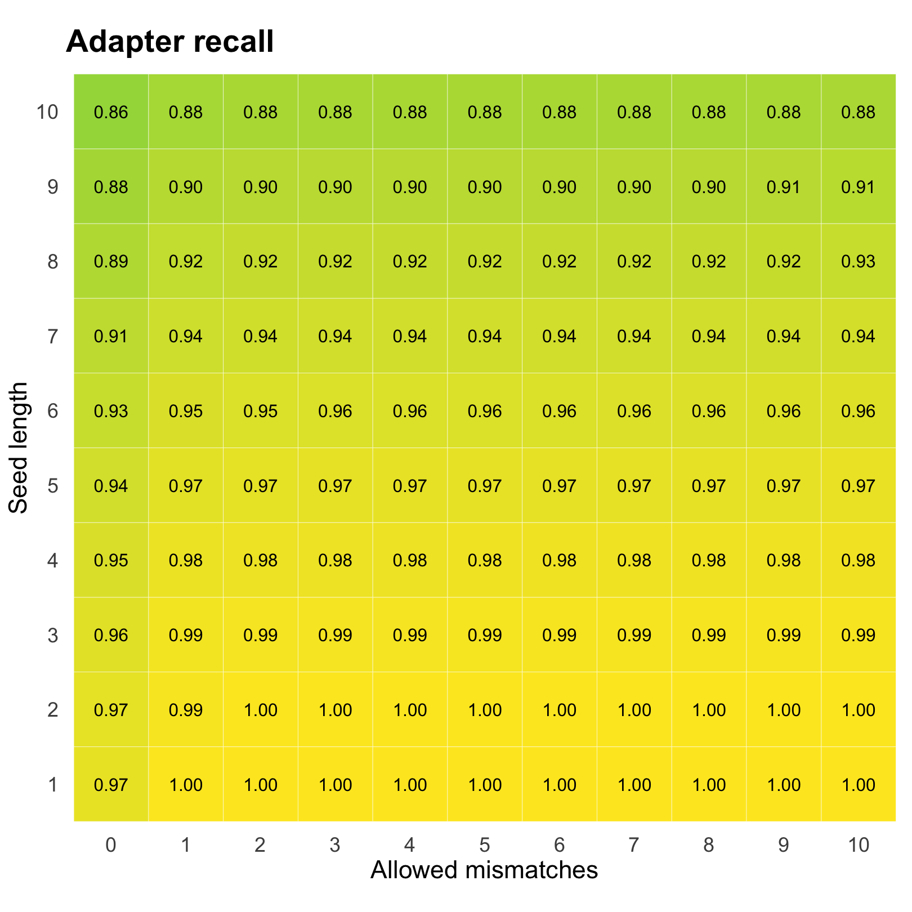<br>
      <sub><b>Figure 1:</b> Recall.</sub>
    </td>
    <td align="center" style="border: 1px solid black; padding: 8px; width: 50%;">
      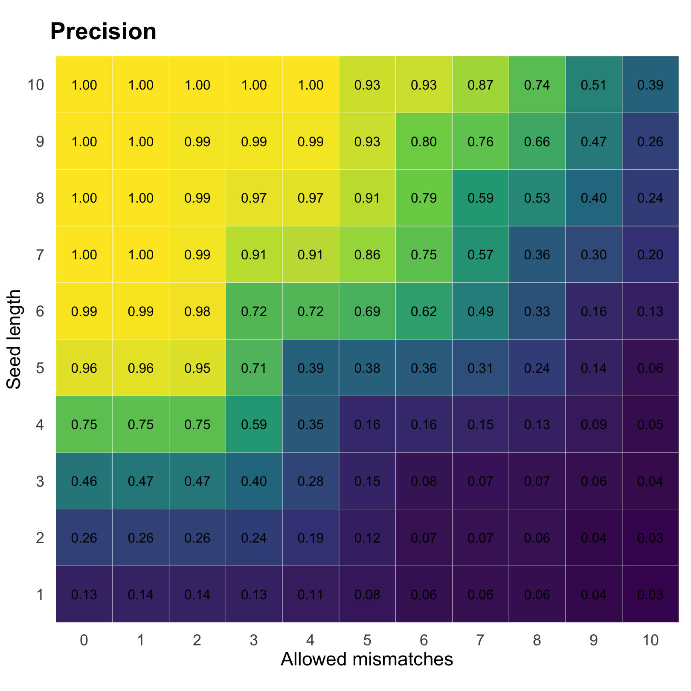<br>
      <sub><b>Figure 2:</b> Precision.</sub>
    </td>
  </tr>
  <tr>
    <td align="center" style="border: 1px solid black; padding: 8px; width: 50%;">
      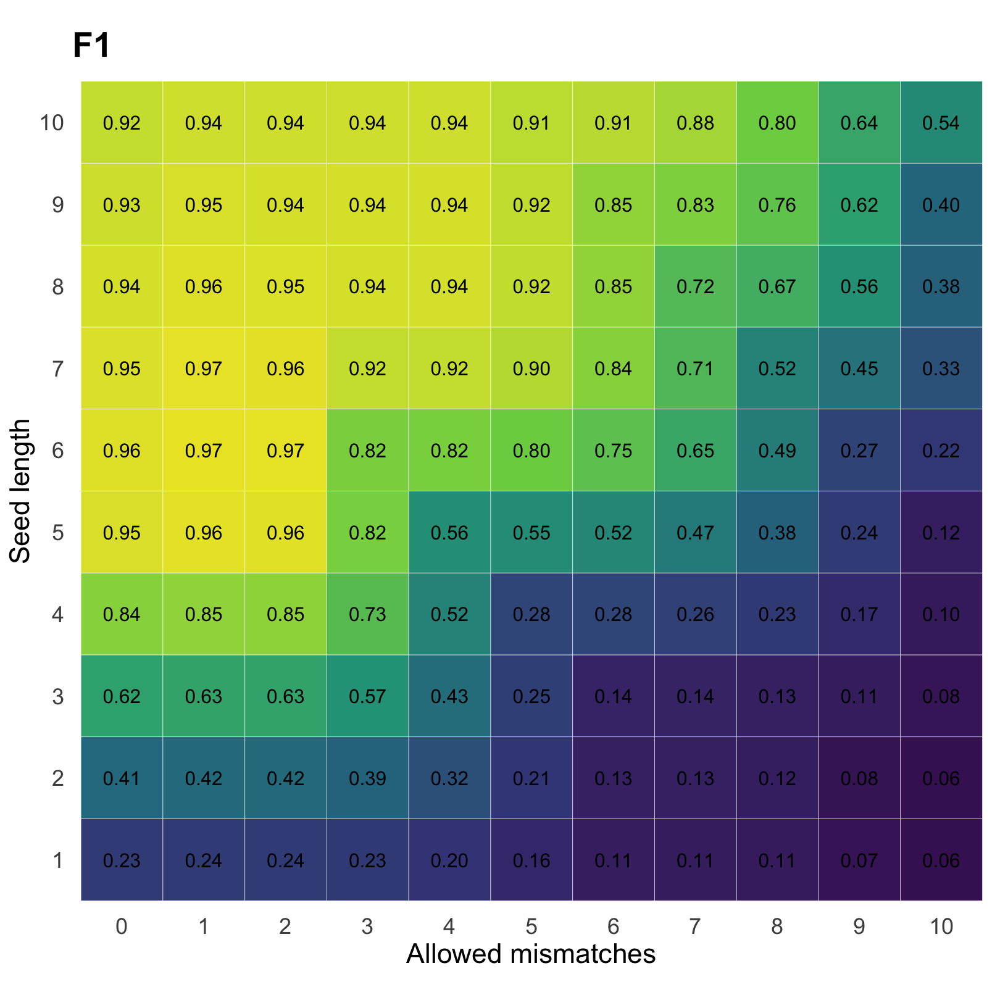<br>
      <sub><b>Figure 3:</b> F1 score.</sub>
    </td>
    <td align="center" style="border: 1px solid black; padding: 8px; width: 50%;">
      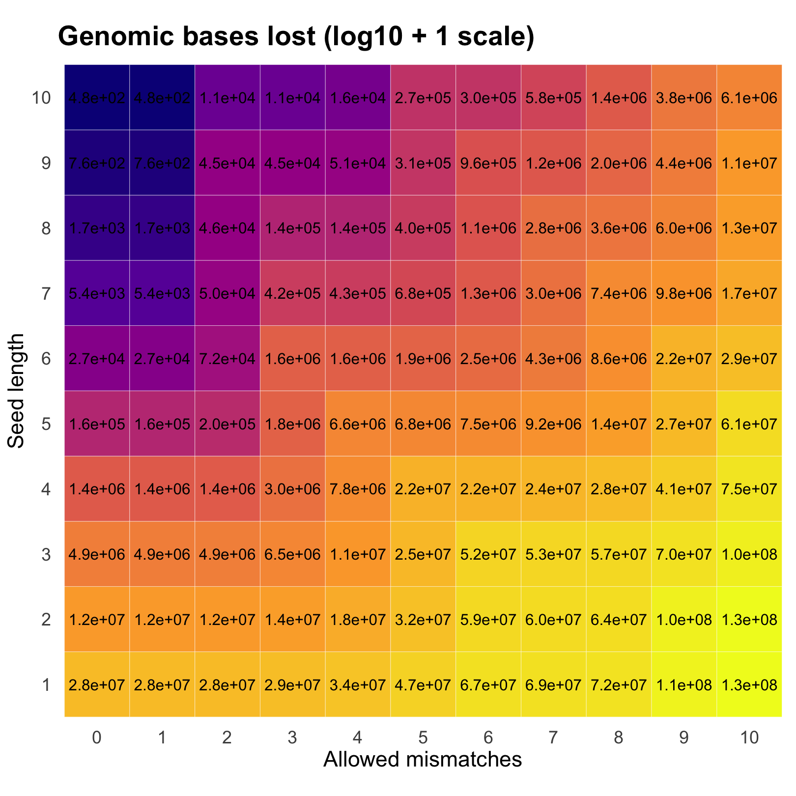<br>
      <sub><b>Figure 4:</b> Genomic bases lost.</sub>
    </td>
  </tr>
</table>

#### Overlapping sequences approach
For paired-end data, when an insert is shorter than the read length, the reads extend past the fragment boundaries into the adapters.
By aligning paired reads against each other, Readzor can clip the non-overlapping adapter tails, without requiring specification of adapter sequences.
Overlaps shorter than `--overlap-min-length` (i.e. an insert shorter than this value) will not be found.
In the overlap-based adapter trimming, the mismatch count can be set to a specified number using `--overlap-mismatches`, and/or be specified as a portion of the overlap using `--overlap-portion-mismatch`.


By setting `--overlap-portion-mismatch` to `100`, we can isolate the effect of the number of mismatches set through `--overlap-mismatches` on the adapter sequences found.
Vice versa, by setting `--overlap-mismatches` to `999`, we could query the behaviour of `--overlap-portion-mismatch`.


Using this approach, we observe that a minimum amount of 2 mismatches is needed within this synthetic dataset, to efficiently trim adapter sequences. Although a higher number of mismatches allowed increases the adapter recall, it reduces precision and the F1 score. In contrast, increasing the minimal overlap reduces recall, whilst increasing precision.

<table style="border: 2px solid black; border-collapse: collapse; width: 100%;">
  <tr>
    <th colspan="2" align="center" style="border: 1px solid black; padding: 12px; background-color: #f6f8fa; font-size: 24px;">
      <b>Overlapping sequences search performance: absolute number of mismatches.</b>
     </th>
   </tr>
   <tr>
    <td align="center" style="border: 1px solid black; padding: 8px; width: 50%;">
      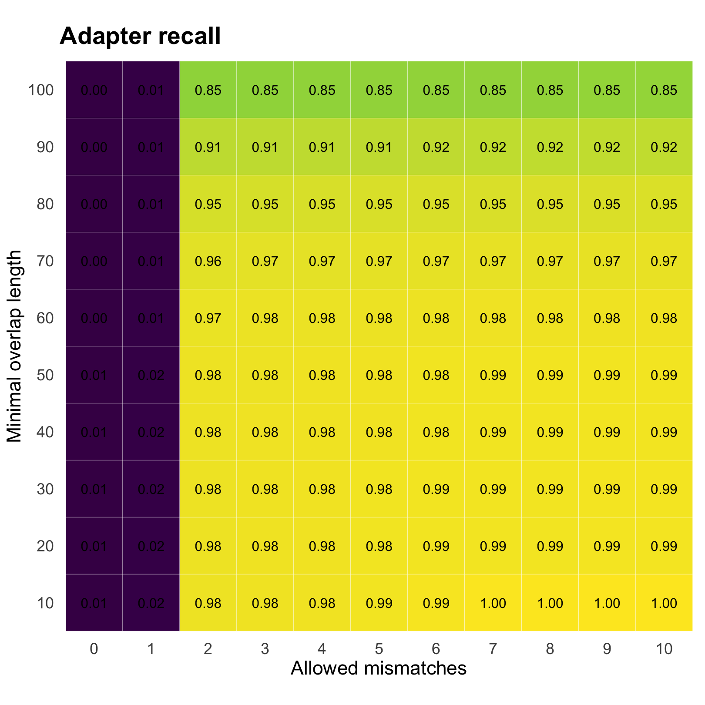<br>
      <sub><b>Figure 1:</b> Recall (adapters successfully found).</sub>
    </td>
    <td align="center" style="border: 1px solid black; padding: 8px; width: 50%;">
      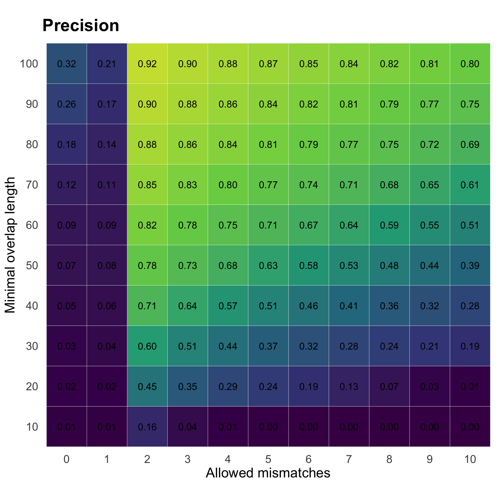<br>
      <sub><b>Figure 2:</b> Precision (portion of removed bases that were from adapters).</sub>
    </td>
  </tr>
  <tr>
    <td align="center" style="border: 1px solid black; padding: 8px; width: 50%;">
      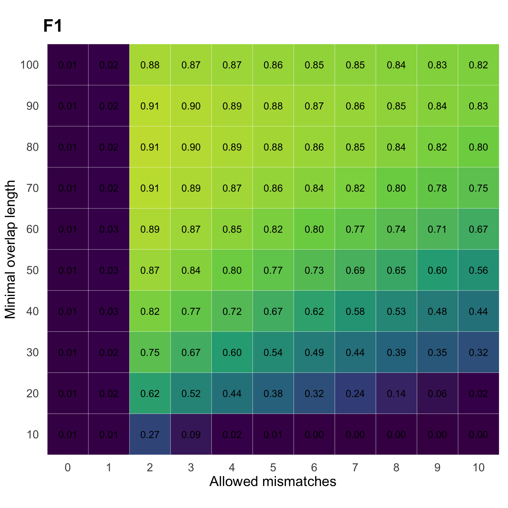<br>
      <sub><b>Figure 3:</b> F1 score (harmonic mean combining precision and recall).</sub>
    </td>
    <td align="center" style="border: 1px solid black; padding: 8px; width: 50%;">
      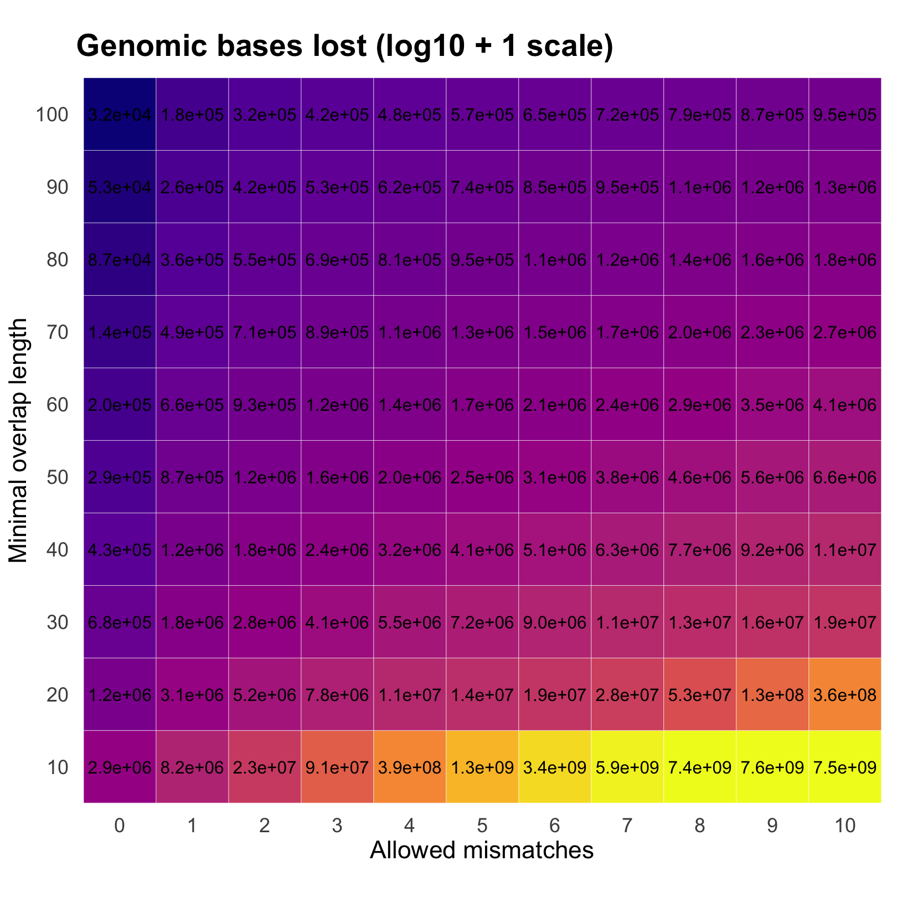<br>
      <sub><b>Figure 4:</b> Genomic bases lost.</sub>
    </td>
  </tr>
</table>

Similarly, when the `--overlap-portion-mismatch` is isolated, we observe that requiring a (near-)perfect match (i.e. low `--overlap-portion-mismatch`), fails to efficiently trim sequences.

<table style="border: 2px solid black; border-collapse: collapse; width: 100%;">
  <tr>
    <th align="center" style="border: 1px solid black; padding: 12px; background-color: #f6f8fa; font-size: 24px;">
      <b>Overlapping sequences search performance: relative number of mismatches.</b>
    </th>
  </tr>
  <tr>
    <td align="center" style="border: 1px solid black; padding: 8px;">
      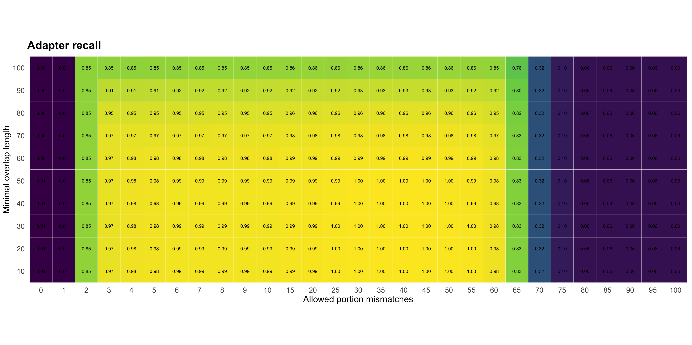<br>
      <sub><b>Figure 1:</b> Recall (adapters successfully found).</sub>
    </td>
  </tr>
  <tr>
    <td align="center" style="border: 1px solid black; padding: 8px;">
      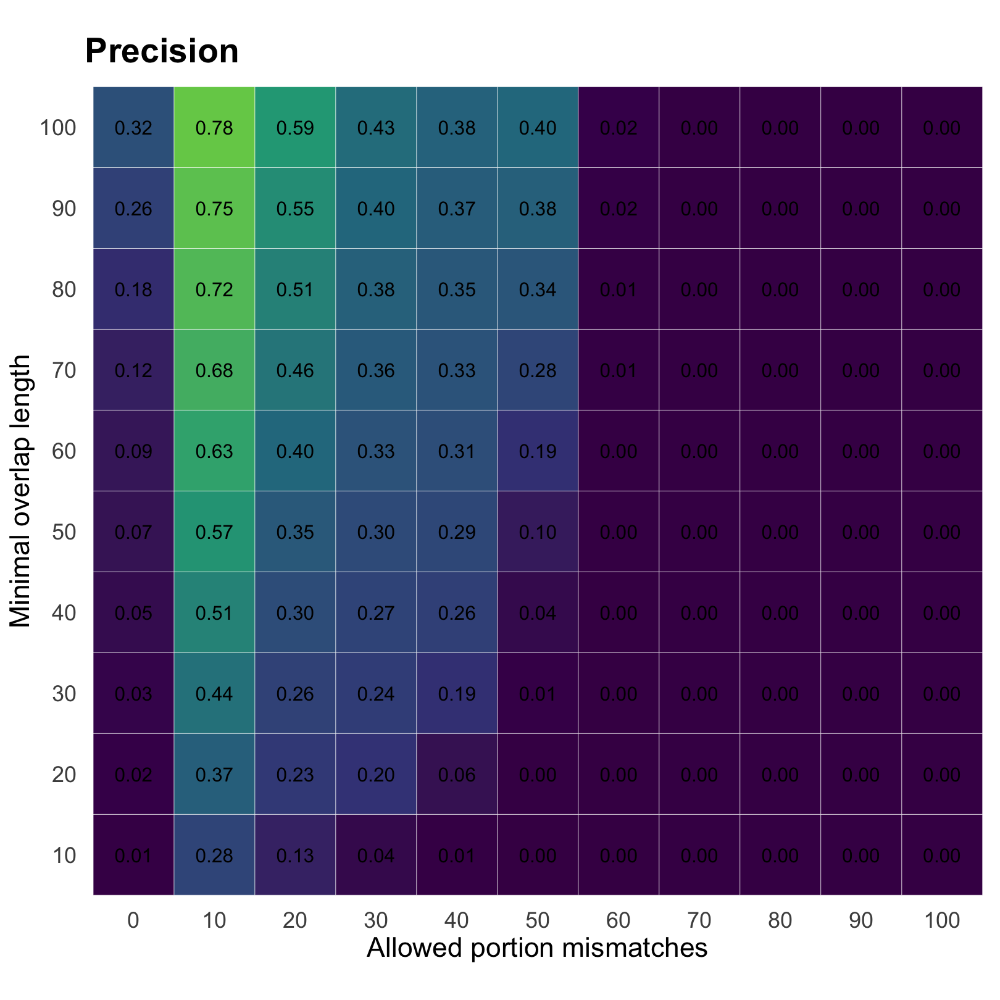<br>
      <sub><b>Figure 2:</b> Precision (portion of removed bases that were from adapters).</sub>
    </td>
  </tr>
  <tr>
    <td align="center" style="border: 1px solid black; padding: 8px;">
      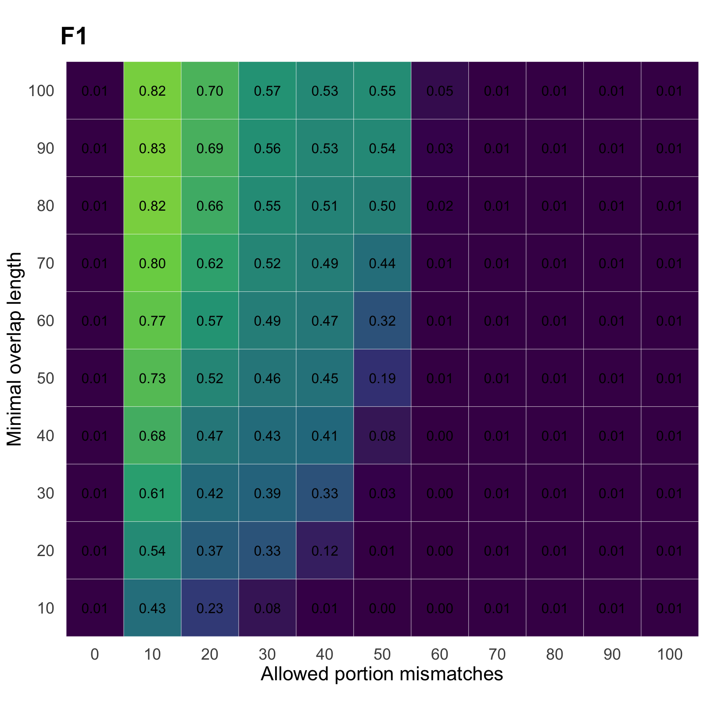<br>
      <sub><b>Figure 3:</b> F1 score (harmonic mean combining precision and recall).</sub>
    </td>
  </tr>
  <tr>
    <td align="center" style="border: 1px solid black; padding: 8px;">
      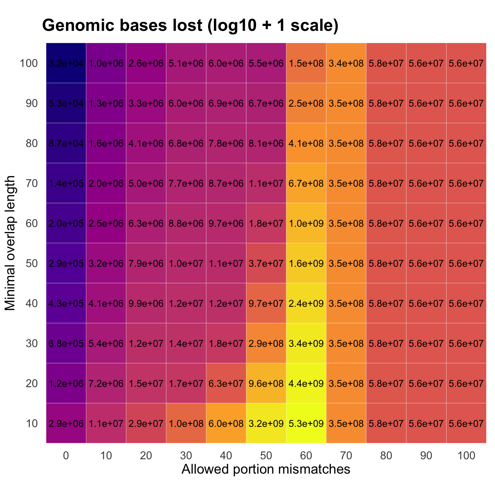<br>
      <sub><b>Figure 4:</b> Genomic bases lost.</sub>
    </td>
  </tr>
</table>

From both these datasets, we observe an inverse correlation between the precision and F1, and number of allowed mismathches, through the rapid increase in genomic bases lost.
A minimal overlap of 50 bp seems to strike a balance between different outcomes.
To further characterize the behaviour of this trimming method, we set the `--overlap-min-length` ot `50`, and varied the mismatch parameters.
As Readzor uses the lowest number of these two settings determines the allowed number of mismatches for a given overlap, we can finetune the overlap search.
For shorter overlaps, `--overlap-portion-mismatch` will determine the number of mismatches allowed, but at longer overlaps, mismatches are capped by `--overlap-mismatches`, preventing widespread aspecific matching.
As the combination of these two methods determine the allowed number of mismatches, a grid-search only needs to perform a limited number of searches, as one of both parameters can act as a _de facto_ cap.

<table style="border: 2px solid black; border-collapse: collapse; width: 100%;">
  <tr>
    <th colspan="2" align="center" style="border: 1px solid black; padding: 12px; background-color: #f6f8fa; font-size: 24px;">
      <b>Overlapping sequences search performance</b>
    </th>
  </tr>
  <tr>
    <td align="center" style="border: 1px solid black; padding: 8px; width: 50%;">
      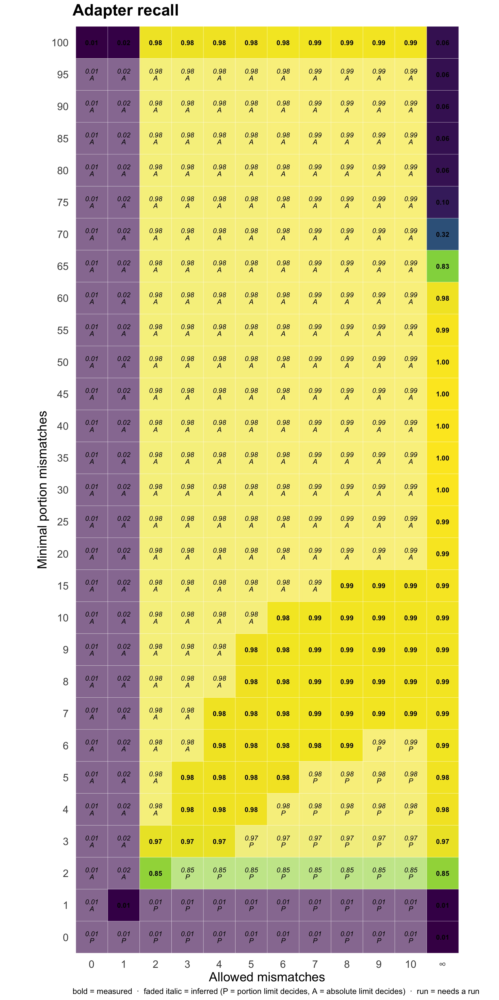<br>
      <sub><b>Figure 1:</b> Recall.</sub>
    </td>
    <td align="center" style="border: 1px solid black; padding: 8px; width: 50%;">
      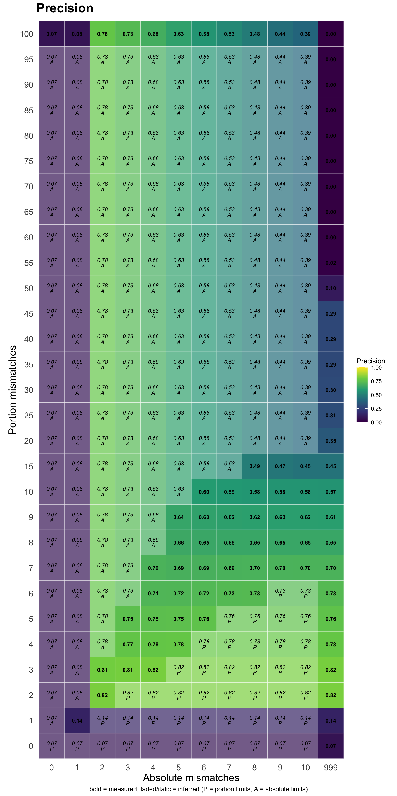<br>
      <sub><b>Figure 2:</b> Precision.</sub>
    </td>
  </tr>
  <tr>
    <td align="center" style="border: 1px solid black; padding: 8px; width: 50%;">
      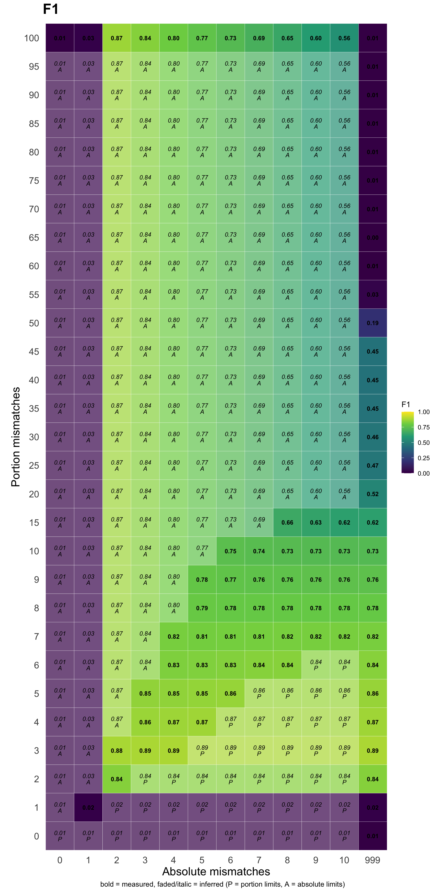<br>
      <sub><b>Figure 3:</b> F1 score.</sub>
    </td>
    <td align="center" style="border: 1px solid black; padding: 8px; width: 50%;">
      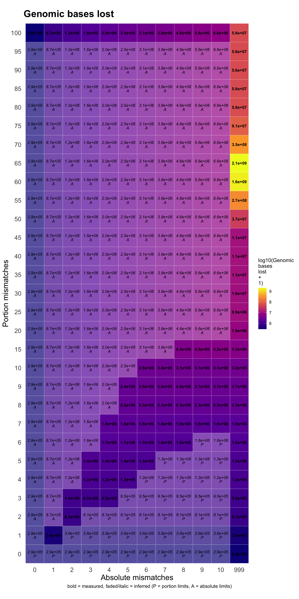<br>
      <sub><b>Figure 4:</b> Genomic bases lost.</sub>
    </td>
  </tr>
</table>

From these results, the default `--overlap-min-length` has been set to `50`, `--overlap-mismatches` to `5`, and `--overlap-portion-mismatch` to `4`.
These settings balance adapter recall, precision, and loss of genomic base pairs.

#### Combined adapter and overlap approach
When desired, both adapter sequence search and overlapping sequences search can be run at the same time.

| Method         | Recall | Precision |    F1 | Genomic bases lost |
|:---------------|-------:|----------:|------:|-------------------:|
| Adapter search |  0.926 |     0.993 | 0.958 |             27,172 |
| Overlap search |  0.951 |     0.990 | 0.970 |              3,876 |
| Combined       |  0.982 |     0.780 | 0.869 |          1,202,900 |

The preset parameters strike a balance between the portion of adapters found, precision, and genomic bases lost. When a more rigorous adapter trimming is desired, the modification of the preset parameters can give the desired outcomes. 
A more detailed overview of the effect of different settings on these parameters can be found in the [benchmarking folder](benchmarking/) in this repository. 

#### Comparison to other short-read trimming tools
To further characterize the performance of Readzor's adpater trimming capabilities, we compared its performance in this area to other popular tools.
As different tools can have different preset parameters, we ran these tools either with preset parameters, or by adapting their paramters to mimick each other (as far as possible).
The majority of the tools can perform adapter trimming based on sequence search, and overlap search. However, some tools perform these analyses without the specification of the user, and without the ability to turn these off. To accurately determine the efficiency of each tools and aproach, their commands have sometimes been altered. The commands used are listed in the [benchmarking folder](benchmarking/) in this repository. 
In addition, we have provided each tools with the same adapter sequences, to further standardize this process.


XXXXX
XXXXX
XXXXX
XXXXX

### Processing time and memory usage (compared to other tools)

Finally, we characterized the processing speed and maximum memory usage of Readzor and other short read trimming tools. For this characterization, two seperate approaches have been studied:
* Finetuning of settings between different short-read trimmers to achieve a similar trimming regime.
* Minimal user-defined settings, to simulate a more straight-forward, low-input approach.

For these comparisons, we benchmarked across a number of CPU threads, and compared the processing time and maximum memory usage.

XXXXX
XXXXX
XXXXX

### File compression
Readzor uses [`isal`](https://github.com/pycompression/python-isal) for its high-performance implementation of the DEFLATE algorithm.
Using a version of Readzor in which both gzip and isal were available, the difference between gzip and isal was benchmarked.For isal, a compression level beyond `1` has no appreciable impact on final output size, yet increases processing time (when set to `3`). The peak memory usage does not increase with compression level. 
For isal, a compression level beyond `1` has no appreciable impact on final output size, yet increases processing time (when set to `3`). The peak memory usage does not increase with compression level. 
The use of isal reduces processing time, when compressed to comparable file size (isal compression level `1` versus gzip compression level `5`).

From these results, the default compression level (`--gzip-level`) for when `--gzip` is set, has been set to `1`.

<table style="border: 2px solid black; border-collapse: collapse; width: 100%;">
  <tr>
    <td align="center" style="border: 1px solid black; padding: 8px; width: 100%;">
      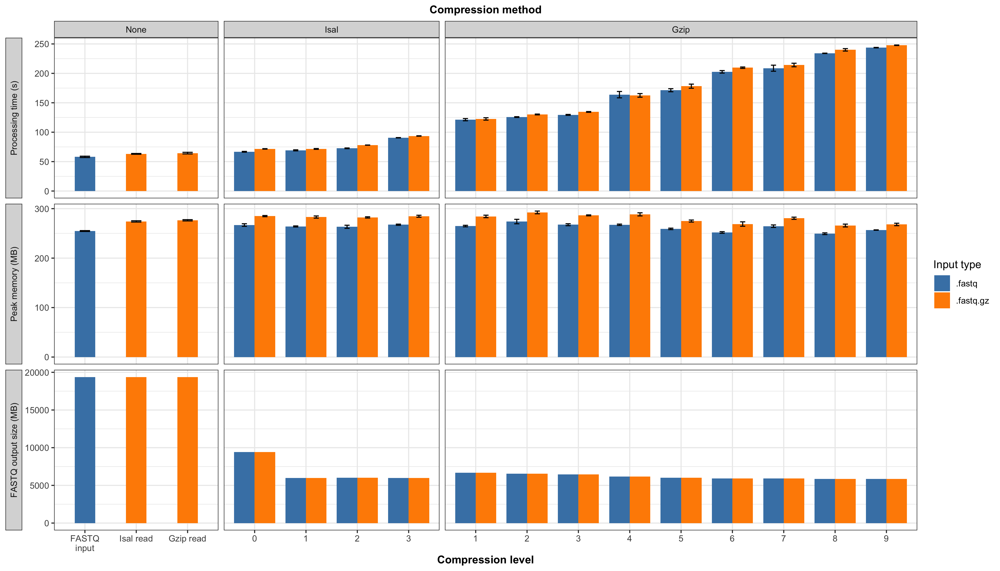<br>
      <sub><b>Figure 1:</b> Isal compression is faster than gzip.</sub>
  </tr>
</table>

### Resource usage across additional modules
Evaluation of the impact of individual Readzor modules on processing time and memory usage.

### Comparison with other short read sequence trimmers


## Benchmarking software and facilities
Readzor has been benchmarked using the [Curnagl](https://wiki.unil.ch/ci/books/high-performance-computing-hpc/page/curnagl) high-performance computering cluster of the University of Lausanne.
During the benchmarking, the following software packages and versions were used:
* [Trimmomatic](https://github.com/usadellab/trimmomatic) (version X.X.X)
* [fastp](https://github.com/opengene/fastp) (version X.X.X)
* [Cutadapt](https://github.com/marcelm/cutadapt/) (version X.X.X)
* [NEAT](https://github.com/ncsa/NEAT) (version 4.7.1)
* [psutil](https://github.com/giampaolo/psutil) (version 7.2.2)

All commands used for benchmarking, and subsequent results, are available from the [benchmarking folder](benchmarking/) in this repository. 


## Software version
Readzor depends on the following software packages:
* NumPy (version required: 2.5.2)
* Python (no version requirement)
* Python-isal (version required: 1.8.0)

Although Readzor works on older versions of Python, it has been developed and tested for best performance using version 3.14.7.

## Issues and bug reports
Please leave a message in [issues](https://github.com/abjanssen/Readzor/issues) or [discussions](https://github.com/abjanssen/Readzor/discussions) if you notice an issue, bug, or otherwise. 

## License
This project is provided under the GNU General Public License v3.0 (GPLv3).

## Author
Axel B. Janssen ([Google Scholar](https://scholar.google.com/citations?user=TWi-ysEAAAAJ&hl)/[GitHub](https://github.com/abjanssen/))

## Reference
Please use the DOI (https://doi.org/10.5281/zenodo.22336649) for your references. 

## Oligonucleotide sequences
The oligonucleotide sequences used for adapter trimming, included in this work, are copyrighted and protected by intellectual property, including issued or pending patents, copyright, and trade secrets.\
Oligonucleotide sequences © 2026 Illumina, Inc. All rights reserved.